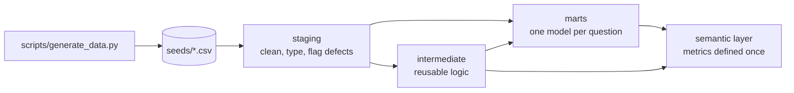
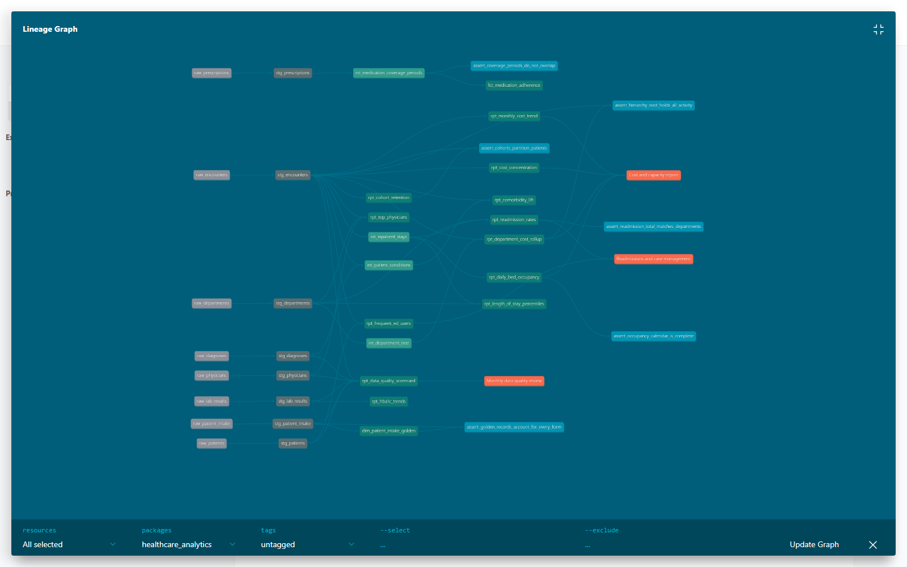

# Advanced SQL for Healthcare Analytics · dbt + DuckDB

[](https://github.com/MariaSLopezOller/advanced-sql-healthcare-analytics/actions/workflows/dbt-build.yml)

Fourteen business questions about a fictional clinic, each answered with a dbt model that shows an
advanced SQL technique: recursive CTEs, gaps and islands, rolling calendar windows, ordered-set
percentiles, cohort matrices, market-basket lift, entity resolution and a data quality scorecard.

All data is **synthetic** and generated by a seeded script. No real patients are involved.
The whole project runs locally in a few seconds: no database server and no credentials needed.

## Quick start

```bash
python -m venv .venv
source .venv/bin/activate          # Windows: .venv\Scripts\activate
pip install -r requirements.txt

dbt build                          # loads seeds, builds 27 models, runs 52 tests
python scripts/preview.py          # prints the first rows of every mart
python scripts/preview.py readmission --rows 20
```

`dbt build` writes everything to `clinic.duckdb`. You can open it with any DuckDB client
(DBeaver, the `duckdb` CLI, or Python) and query the `marts` schema directly.
`dbt docs generate && dbt docs serve` opens the lineage graph and column documentation.

## The questions

| # | Model | Business question | SQL techniques |
|---|---|---|---|
| 01 | [`rpt_department_cost_rollup`](models/marts/rpt_department_cost_rollup.sql) | How much cost does each level of the organisation carry, including its sub-departments? | Recursive CTE, closure table, roll-up through a hierarchy |
| 02 | [`rpt_daily_bed_occupancy`](models/marts/rpt_daily_bed_occupancy.sql) | How many beds were occupied each day, and which days were peaks? | `generate_series` date spine, interval join, open intervals, moving average |
| 03 | [`rpt_readmission_rates`](models/marts/rpt_readmission_rates.sql) | Which departments have the most 30-day readmissions? | `LEAD`, `ROLLUP` + `GROUPING()`, `FILTER`, Jinja-generated pivot |
| 04 | [`rpt_top_physicians`](models/marts/rpt_top_physicians.sql) | Who carries the workload in each department? | Top-N per group, `DENSE_RANK`, `QUALIFY`, named `WINDOW` |
| 05 | [`rpt_monthly_cost_trend`](models/marts/rpt_monthly_cost_trend.sql) | How is spending evolving through the year? | Running total, `LAG` month-over-month, moving average, share of total |
| 06 | [`rpt_length_of_stay_percentiles`](models/marts/rpt_length_of_stay_percentiles.sql) | What is a typical stay, and how long is the tail? | `PERCENTILE_CONT` / `PERCENTILE_DISC ... WITHIN GROUP`, outliers vs. median |
| 07 | [`fct_medication_adherence`](models/marts/fct_medication_adherence.sql) | Which chronic patients have treatment gaps or a PDC below 80%? | **Gaps and islands**, interval merging with running `MAX`, PDC metric |
| 08 | [`rpt_cohort_retention`](models/marts/rpt_cohort_retention.sql) | Of patients first seen in a month, how many come back later? | Cohort assignment with `MIN() OVER`, retention matrix |
| 09 | [`rpt_hba1c_trends`](models/marts/rpt_hba1c_trends.sql) | Are diabetic patients improving? How many reach the <7% target? | `arg_min` / `arg_max`, `LAG`, filtering implausible values |
| 10 | [`rpt_comorbidity_lift`](models/marts/rpt_comorbidity_lift.sql) | Which chronic conditions appear together more than chance predicts? | Market-basket analysis: support, confidence, lift via self-join |
| 11 | [`rpt_frequent_ed_users`](models/marts/rpt_frequent_ed_users.sql) | Who had 3+ emergency visits in any 90-day window? | `RANGE BETWEEN INTERVAL 89 DAYS PRECEDING`, `QUALIFY` |
| 12 | [`rpt_cost_concentration`](models/marts/rpt_cost_concentration.sql) | Does the 80/20 rule hold for patient cost? | `NTILE`, window over aggregates (`sum(sum(x)) over ...`) |
| 13 | [`dim_patient_intake_golden`](models/marts/dim_patient_intake_golden.sql) | How many real people are behind the duplicated intake forms? | Entity resolution, survivorship with `FIRST_VALUE ... IGNORE NULLS` |
| 14 | [`rpt_data_quality_scorecard`](models/marts/rpt_data_quality_scorecard.sql) | Can the numbers be trusted? | Rule catalogue across quality dimensions, anti-joins, PASS/WARN/FAIL |

### What the data says

- **Readmissions:** 19.8% of eligible inpatient discharges return within 30 days; Internal Medicine is highest at 23.8%.
- **Cost concentration:** the costliest 10% of patients account for 40.7% of spending, and the top 30% for 81.3%.
- **Adherence:** 84 of 474 patient–drug treatments (17.7%) fall below the 80% proportion-of-days-covered threshold.
- **Emergency use:** 19 patients had 3 or more emergency visits within a 90-day window, a list for case management.
- **Diabetes control:** of 109 diabetic patients with repeated tests, 30 are improving and 39 are worsening.
- **Comorbidity:** diabetes and hypertension co-occur 1.44 times more often than independence would predict.
- **Data quality:** 6 rules fail, 2 are within tolerance and 2 pass. The defects were planted on purpose and are caught by both the scorecard and dbt tests.

## Project structure



```
├── seeds/          raw CSVs produced by scripts/generate_data.py (seed = 42)
├── models/
│   ├── staging/        stg_*: casting, normalisation, quality flags (views)
│   ├── intermediate/   int_*: hierarchy closure, inpatient stays with LEAD,
│   │                   medication coverage periods (gaps & islands), patient conditions
│   ├── marts/          14 tables, one per business question
│   └── semantic/       MetricFlow semantic models, metrics and the time spine
├── macros/         safe_pct() and schema naming
├── tests/          singular tests + a custom generic test (in_range)
└── scripts/        data generator, results preview, catalogue and metrics checks
```

**Modelling choices**

- **Defects are flagged, not hidden.** Staging keeps bad rows and adds flags such as `has_valid_dates` and `is_plausible`.
  Each mart decides what to exclude, and the scorecard counts what was excluded.
- **Business rules are variables.** The observation period, the readmission window (30 days) and the
  PDC threshold (0.8) live in `dbt_project.yml` and can be changed with `--vars`.
- **Tests verify logic as well as schema.** Beyond `unique`, `not_null`, `relationships` and `accepted_values`,
  singular tests check invariants. Merged coverage periods never overlap, the hierarchy root holds every encounter,
  deduplication loses no forms, cohorts split patients exactly, and the hospital total equals the sum of departments.
- **Known defects warn, real breaks fail.** The planted orphan physician, the stays whose discharge date comes before
  admission and the impossible lab values are tested with `severity: warn`. They are reported on every run
  without blocking the build.

## Catalogue and lineage

**Browse it:** [mariaslopezoller.github.io/advanced-sql-healthcare-analytics](https://mariaslopezoller.github.io/advanced-sql-healthcare-analytics/)
(the dbt docs site, rebuilt and published by [a GitHub Actions workflow](.github/workflows/docs.yml) on every push).



The dbt docs double as a data catalogue. Every model and seed records:

- **An owner.** Each model belongs to a [group](models/_groups.yml) with a named owner: data platform, clinical analytics or data governance. The clinic is fictional, so owners are roles.
- **A data classification:** `internal`, `personal` or `special_category` (health data under UK GDPR Article 9), plus whether it holds personal data. Set by layer in [`dbt_project.yml`](dbt_project.yml), with overrides where a model differs. Aggregated marts are `internal`; patient-level ones stay `special_category`.
- **Personal data columns**, tagged as `direct_identifier`, `quasi_identifier` or `special_category`.
- **Downstream consumers.** [Exposures](models/_exposures.yml) end the lineage graph at the reports that use each mart, so a change can be traced to who it affects. They are illustrative.

[`scripts/check_catalog.py`](scripts/check_catalog.py) runs in CI after `dbt build` and **fails the build** if any model or seed has no
description or classification, or any model has no owner. It also prints the inventory of personal data columns (25 at the moment).

```bash
dbt docs generate && dbt docs serve      # browse the catalogue and lineage locally
python scripts/check_catalog.py          # governance check on the catalogue
```

## Semantic layer

The marts answer fixed questions. The semantic layer lets anyone ask a new one without
rewriting the definition of the metric. Each metric lives once in
[`models/semantic/_semantic_layer.yml`](models/semantic/_semantic_layer.yml), with a description and an owner,
and MetricFlow writes the SQL when someone asks for it by name.

| Metric | Built on | Value (2025) |
|---|---|---:|
| `new_patients` | `dim_patient_intake_golden` (one row per real person) | 322 |
| `intake_forms_received` | `stg_patient_intake` (forms as submitted, duplicates included) | 439 |
| `readmission_rate_30d` | `int_inpatient_stays` (eligible discharges only) | 19.8% |
| `adherence_rate` | `fct_medication_adherence` (PDC at or above 0.8) | 82.3% |

`new_patients` and `intake_forms_received` are kept apart on purpose. Counting patients from the raw
forms gives 439 instead of 322, so the patient count is defined on the deduplicated table and the
form count has a name that says what it is.

```bash
mf query --metrics new_patients,intake_forms_received --group-by metric_time__quarter
mf query --metrics readmission_rate_30d --group-by department__department_name
python scripts/check_metrics.py          # every metric must match its mart
```

[`scripts/check_metrics.py`](scripts/check_metrics.py) runs in CI and fails if a metric and the mart that answers the
same question stop agreeing. On Windows, set `PYTHONUTF8=1` before running `mf`.

## Data model

| Table | Rows | Description |
|---|---:|---|
| `raw_departments` | 11 | Hierarchy: Hospital › Division › Department |
| `raw_physicians` | 23 | Physicians assigned to leaf departments |
| `raw_patients` | 600 | Demographics |
| `raw_encounters` | 1,983 | Outpatient, emergency and inpatient visits in 2025 |
| `raw_diagnoses` | 3,472 | ICD-10 codes per encounter (one primary) |
| `raw_prescriptions` | 3,593 | Pharmacy fills for chronic treatments |
| `raw_lab_results` | 856 | HbA1c and LDL results |
| `raw_patient_intake` | 439 | Raw intake forms with duplicates and dirty values |

Regenerate the data with `python scripts/generate_data.py`. The output is deterministic.

## Portability notes

The models use the DuckDB dialect. Most of the SQL is standard. The DuckDB-specific parts and their equivalents are:

| DuckDB | PostgreSQL | Snowflake / BigQuery |
|---|---|---|
| `QUALIFY` | subquery + `WHERE` | `QUALIFY` |
| `count_if(x)` | `count(*) filter (where x)` | `count_if(x)` / `countif(x)` |
| `arg_max(v, t)` | `(array_agg(v order by t desc))[1]` | `max_by(v, t)` / `array_agg(...)[offset(0)]` |
| `date_diff('day', a, b)` | `b - a` | `datediff(day, a, b)` / `date_diff(b, a, day)` |
| `group by all` | list the columns | `group by all` (Snowflake) |

## License

MIT, see [LICENSE](LICENSE).
